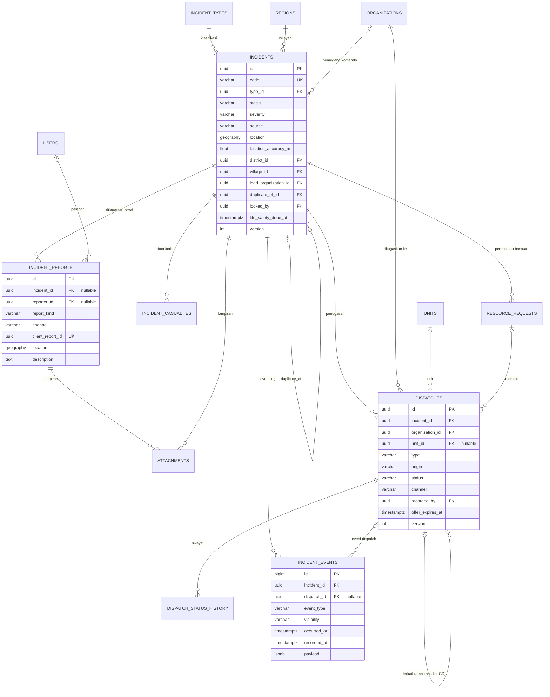
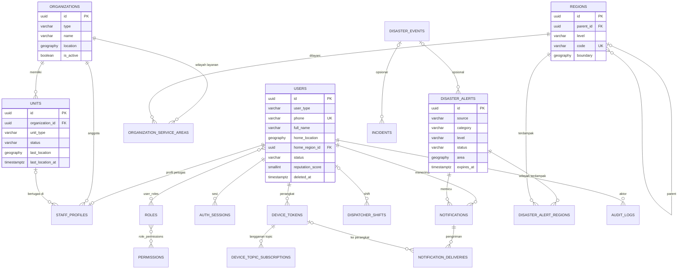

# ERD v1: Aplikasi Informasi Bencana & Kejadian Darurat

> Status: draft v1.3 (belum dieksekusi jadi migrasi). v1.1 = penyesuaian dari kontrak REST API, v1.2 = penyesuaian dari spesifikasi FCM, v1.3 = tabel outbox dari dokumen serah terima. Lihat bagian 10
> Tanggal: 5 Oktober 2026
> Acuan: `konsep-aplikasi-darurat.md` (v2/v3)
> Target: PostgreSQL 15+ dengan PostGIS. Tanda 🔶 = keputusan desain yang perlu ditinjau.

---

## 1. Konvensi

| Topik | Keputusan |
|---|---|
| Primary key | `uuid` (disarankan UUIDv7, terurut waktu). Alasan: tidak bisa ditebak, dan id bisa dibuat di sisi klien (antrean offline Flutter). Pengecualian: `incident_events` dan `audit_logs` memakai `bigint identity` karena butuh urutan global untuk sinkronisasi |
| Kode yang terbaca manusia | `incidents.code` format `INC-YYYYMMDD-NNNNNN` (urutan harian) |
| Waktu | Semua `timestamptz` (UTC). `created_at`, `updated_at` di hampir semua tabel |
| Lokasi | `geography(Point, 4326)` untuk titik, `geography(MultiPolygon, 4326)` untuk area. Semua kolom lokasi diberi **GiST index** |
| Status dan tipe | `varchar` + `CHECK` (opsional), **bukan enum PostgreSQL**, agar menambah nilai tidak perlu migrasi struktural. Nilai yang diperbolehkan didokumentasikan di bagian 6 dan divalidasi di aplikasi |
| Data referensi/konfigurasi | Jenis kejadian, role, permission, pengaturan sistem disimpan sebagai **data**, bukan kode |
| Soft delete | Hanya `users` (`deleted_at`). Data kejadian tidak dihapus, hanya dianonimkan saat retensi berakhir |
| Optimistic locking | Kolom `version int` pada `incidents` dan `dispatches` (mencegah dua operator menimpa perubahan) |
| JSONB | Hanya untuk data yang memang tidak pasti (`payload`, `meta`). Data inti (lokasi, status, relasi) tetap kolom biasa agar bisa di-index |
| Data pribadi | **Tabel `incidents` tidak berisi data pelapor.** Identitas dan kontak ada di `incident_reports` dan `users`, sehingga mudah dibatasi aksesnya dan dianonimkan |

---

## 2. Diagram: Domain Kejadian (inti)

## 3. Diagram: Identitas, Organisasi, Notifikasi, Alert

---

## 4. Daftar Tabel dan Fase

| Kelompok | Tabel | Fase |
|---|---|---|
| Identitas & akses | `users`, `staff_profiles`, `roles`, `permissions`, `role_permissions`, `user_roles`, `auth_sessions`, `otp_requests`, `device_tokens` | 1 |
| Wilayah & organisasi | `regions`, `organizations`, `organization_service_areas`, `units` | 1 |
| Referensi | `incident_types`, `system_settings` | 1 |
| Kejadian | `incidents`, `incident_reports`, `attachments`, `incident_casualties` | 1 |
| Penugasan | `dispatches`, `dispatch_status_history`, `resource_requests` | 1 |
| Log | `incident_events`, `audit_logs`, `outbox_events` | 1 |
| Operasional | `dispatcher_shifts` | 1 |
| Notifikasi | `notifications`, `notification_deliveries`, `device_topic_subscriptions` | 1 |
| Alert bencana | `disaster_alerts`, `disaster_alert_regions` | 1 (manual), 2 (otomatis BMKG) |
| Peristiwa induk | `disaster_events` | 2 🔶 (opsional) |

Total 32 tabel, 31 di antaranya masuk fase 1.

---

## 5. Spesifikasi Kolom

Format: `Kolom | Tipe | Null | Keterangan`. PK dan `created_at`/`updated_at` standar tidak diulang di setiap tabel kecuali ada kekhususan.

### 5.1 Identitas & akses

**`users`** (warga dan petugas dalam satu tabel)

| Kolom | Tipe | Null | Keterangan |
|---|---|---|---|
| id | uuid | | PK |
| user_type | varchar(16) | | `CITIZEN` / `STAFF` |
| full_name | varchar(150) | | |
| phone | varchar(20) | | **Unique**, format E.164 |
| phone_verified_at | timestamptz | ✓ | Terisi setelah OTP berhasil |
| email | varchar(150) | ✓ | |
| password_hash | varchar(255) | ✓ | Untuk petugas/admin. Warga login via OTP |
| two_factor_enabled | boolean | | Wajib true untuk dispatcher dan supervisor |
| two_factor_secret | varchar(255) | ✓ | Disimpan terenkripsi |
| must_change_password | boolean | | True untuk akun staf baru/direset |
| home_location | geography(Point) | ✓ | Lokasi rumah warga (untuk alert berbasis lokasi) |
| home_address | text | ✓ | |
| home_region_id | uuid FK regions | ✓ | Kelurahan/desa rumah |
| status | varchar(16) | | `ACTIVE`, `SUSPENDED`, `DEACTIVATED` |
| reputation_score | smallint | | Default 0. Naik/turun dari riwayat laporan valid/INVALID |
| last_login_at | timestamptz | ✓ | |
| deleted_at | timestamptz | ✓ | Soft delete |

Index: unique(`phone`), GiST(`home_location`), (`home_region_id`) untuk broadcast alert per wilayah.

**`staff_profiles`**: profil petugas (1 user ke 1 profil) 🔶

| Kolom | Tipe | Null | Keterangan |
|---|---|---|---|
| user_id | uuid PK, FK users | | |
| organization_id | uuid FK organizations | | Satu petugas, satu organisasi (MVP) |
| unit_id | uuid FK units | ✓ | Null untuk admin organisasi, dispatcher, supervisor |
| employee_no | varchar(50) | ✓ | |
| position | varchar(100) | ✓ | |
| is_active | boolean | | |

> Dispatcher dan supervisor command center juga punya `staff_profiles`, dengan `organization_id` menunjuk organisasi "Command Center" (dibuat sebagai baris di `organizations` bertipe `COMMAND_CENTER`).

**`roles`**: `id`, `code` (unique: `CITIZEN`, `RESPONDER`, `ORG_ADMIN`, `DISPATCHER`, `SUPERVISOR`, `SUPER_ADMIN`), `name`, `description`.
**`permissions`**: `id`, `code` (unique: `incident.verify`, `dispatch.create`, `milestone.create`, `alert.create`, dst.), `description`.
**`role_permissions`**: PK gabungan (`role_id`, `permission_id`).
**`user_roles`**: PK gabungan (`user_id`, `role_id`). Satu akun boleh banyak role. 🔶

Pengecekan relasi (lead, terkait, own) tidak disimpan di tabel, tetapi dihitung di policy layer berdasarkan `incidents.lead_organization_id` dan `dispatches`.

**`auth_sessions`**: `id`, `user_id` FK, `device_token_id` FK (null), `refresh_token_hash`, `ip_address`, `user_agent`, `expires_at`, `revoked_at`, `created_at`. Index (`user_id`), (`expires_at`).

**`otp_requests`**: `id`, `phone`, `code_hash`, `purpose` (`REGISTER`, `LOGIN`, `RESET`), `attempts` smallint, `expires_at`, `verified_at` (null), `created_at`. Index (`phone`, `created_at`). Rate limit utama di Redis, tabel ini untuk jejak audit.

**`device_tokens`**

| Kolom | Tipe | Null | Keterangan |
|---|---|---|---|
| id | uuid | | |
| user_id | uuid FK | | |
| fcm_token | varchar(255) | | **Unique** |
| platform | varchar(10) | | `ANDROID`, `IOS`, `WEB` |
| app_flavor | varchar(20) | | `CITIZEN`, `STAFF` |
| app_version | varchar(20) | ✓ | |
| last_seen_at | timestamptz | ✓ | |
| push_enabled | boolean | | Izin notifikasi aktif di perangkat (dilaporkan klien). False = petugas tidak dapat dihubungi lewat push |
| revoked_at | timestamptz | ✓ | Diisi saat logout/akun dinonaktifkan |

Index: (`user_id`) where `revoked_at is null`.

### 5.2 Wilayah & organisasi

**`regions`**

| Kolom | Tipe | Null | Keterangan |
|---|---|---|---|
| id | uuid | | |
| parent_id | uuid FK regions | ✓ | Kota/kab → kecamatan → kelurahan/desa |
| level | varchar(16) | | `CITY`, `DISTRICT`, `VILLAGE` |
| code | varchar(20) | | **Unique**, kode Kemendagri |
| name | varchar(150) | | |
| boundary | geography(MultiPolygon) | ✓ | |
| centroid | geography(Point) | ✓ | |

Index: GiST(`boundary`), (`parent_id`), (`level`).

**`organizations`**

| Kolom | Tipe | Null | Keterangan |
|---|---|---|---|
| id | uuid | | |
| type | varchar(24) | | `COMMAND_CENTER`, `POLICE`, `FIRE`, `HOSPITAL`, `BPBD`, `AMBULANCE_SERVICE`, `PRIVATE_FIRE`, `DISHUB`, `OTHER` |
| name | varchar(150) | | |
| code | varchar(30) | ✓ | Unique |
| phone | varchar(20) | ✓ | Nomor operasional, jalur cadangan telepon |
| address | text | ✓ | |
| location | geography(Point) | ✓ | |
| service_polygon | geography(MultiPolygon) | ✓ | Opsional, bila wilayah layanan bukan per kecamatan |
| is_active | boolean | | |
| meta | jsonb | ✓ | |

**`organization_service_areas`**: PK gabungan (`organization_id`, `region_id`). Dasar rekomendasi stakeholder saat dispatch.

**`units`**

| Kolom | Tipe | Null | Keterangan |
|---|---|---|---|
| id | uuid | | |
| organization_id | uuid FK | | |
| code | varchar(30) | | Unique per organisasi, mis. `AMB-01` |
| name | varchar(100) | | |
| unit_type | varchar(24) | | `AMBULANCE`, `FIRE_ENGINE`, `RESCUE_TEAM`, `ER` (IGD), `PATROL`, `OTHER` |
| plate_number | varchar(15) | ✓ | |
| status | varchar(16) | | `AVAILABLE`, `BUSY`, `OFFLINE`, `OUT_OF_SERVICE` |
| last_location | geography(Point) | ✓ | |
| last_location_at | timestamptz | ✓ | |
| is_active | boolean | | |
| meta | jsonb | ✓ | Kapasitas, perlengkapan, dsb. |

Index: (`organization_id`, `status`), GiST(`last_location`).

> Riwayat posisi unit (live tracking) **tidak** dimasukkan di fase 1. Fase 3 sebaiknya memakai tabel terpisah (`unit_location_logs`, dipartisi per waktu) agar `units` tetap ringan. Di fase 1 cukup `last_location`.

### 5.3 Referensi

**`incident_types`**

| Kolom | Tipe | Null | Keterangan |
|---|---|---|---|
| id | uuid | | |
| code | varchar(40) | | Unique, mis. `TRAFFIC_ACCIDENT`, `FIRE`, `FLOOD`, `MEDICAL` |
| name | varchar(100) | | |
| category | varchar(24) | | `TRAFFIC`, `FIRE`, `MEDICAL`, `NATURAL_DISASTER`, `OTHER` |
| default_lead_org_type | varchar(24) | ✓ | `POLICE`, `FIRE`, `BPBD`. Dipakai mengisi `lead_organization` otomatis |
| suggested_resources | jsonb | ✓ | Checklist rekomendasi, mis. `[{"org_type":"HOSPITAL","dispatch_type":"NOTIFY"}]` |
| allows_condition_report | boolean | | True untuk banjir (laporan kondisi tanpa dispatch) |
| is_active | boolean | | |
| sort_order | int | | |

**`system_settings`**: `key` (PK), `value` jsonb, `description`, `updated_by`, `updated_at`. Contoh kunci: `offer_timeout_seconds`, `unhandled_incident_escalation_minutes`, `auto_close_hours`, `operating_hours`, `report_rate_limit`.

### 5.4 Kejadian

**`incidents`**

| Kolom | Tipe | Null | Keterangan |
|---|---|---|---|
| id | uuid | | |
| code | varchar(24) | | **Unique**, `INC-YYYYMMDD-NNNNNN` |
| type_id | uuid FK incident_types | | |
| status | varchar(16) | | `SUBMITTED`, `VERIFIED`, `IN_PROGRESS`, `RESOLVED`, `CLOSED`, `INVALID`, `DUPLICATE` |
| severity | varchar(12) | ✓ | `LOW`, `MEDIUM`, `HIGH`, `MASS` |
| escalation_level | smallint | ✓ | Level kebakaran/bencana (1-3), makna mengikuti jenis kejadian |
| source | varchar(20) | | `MOBILE_APP`, `ADMIN_MANUAL`, `CALL_CENTER_112` |
| external_ref_id | varchar(100) | ✓ | Nomor tiket sistem lain |
| summary | varchar(255) | ✓ | Ringkasan oleh dispatcher |
| location | geography(Point) | | Lokasi presisi (disaring di serializer sesuai role) |
| location_accuracy_m | real | ✓ | |
| address_text | text | ✓ | |
| district_id | uuid FK regions | ✓ | Kecamatan |
| village_id | uuid FK regions | ✓ | Kelurahan/desa |
| lead_organization_id | uuid FK organizations | ✓ | Pemegang komando |
| lead_set_at | timestamptz | ✓ | |
| locked_by | uuid FK users | ✓ | Dispatcher yang sedang menangani |
| locked_at | timestamptz | ✓ | |
| lock_expires_at | timestamptz | ✓ | Lepas otomatis bila sesi berakhir |
| verified_by | uuid FK users | ✓ | |
| verified_at | timestamptz | ✓ | |
| invalid_reason | text | ✓ | Wajib bila `INVALID` |
| duplicate_of_id | uuid FK incidents | ✓ | Wajib bila `DUPLICATE` |
| disaster_event_id | uuid FK disaster_events | ✓ | Fase 2 🔶 |
| report_count | int | | Denormalisasi jumlah laporan tertaut |
| flags | jsonb | ✓ | Penanda sistem, mis. `["OUT_OF_AREA"]` |
| first_reported_at | timestamptz | | |
| life_safety_done_at | timestamptz | ✓ | Penanda "semua korban sudah ditangani" 🔶 |
| resolved_at, closed_at | timestamptz | ✓ | |
| version | int | | Optimistic locking |

Index:
- GiST(`location`)
- (`status`, `created_at` desc) untuk antrean dispatcher
- Partial: (`created_at`) where `status` in (`SUBMITTED`,`VERIFIED`,`IN_PROGRESS`) untuk incident aktif
- (`district_id`, `status`), (`type_id`), (`lead_organization_id`), (`duplicate_of_id`)

**`incident_reports`**: laporan warga atau input manual dispatcher

| Kolom | Tipe | Null | Keterangan |
|---|---|---|---|
| id | uuid | | |
| incident_id | uuid FK incidents | ✓ | **Null** untuk `CONDITION_REPORT` yang tidak jadi incident |
| suggested_incident_id | uuid FK incidents | ✓ | Saran penautan otomatis, dikonfirmasi dispatcher 🔶 |
| report_kind | varchar(20) | | `HELP_REQUEST`, `CONDITION_REPORT` |
| type_id | uuid FK incident_types | | Jenis menurut pelapor |
| reporter_id | uuid FK users | ✓ | Null bila dicatat dispatcher untuk penelepon tanpa akun |
| reporter_name | varchar(150) | ✓ | Untuk input manual |
| reporter_phone | varchar(20) | ✓ | Untuk input manual |
| entered_by | uuid FK users | ✓ | Dispatcher yang mengetik (input manual) |
| channel | varchar(16) | | `APP`, `PHONE`, `WHATSAPP`, `SMS` |
| client_report_id | uuid | ✓ | **Unique**, kunci idempotensi dari antrean offline |
| location | geography(Point) | | |
| location_accuracy_m | real | ✓ | |
| address_text | text | ✓ | Alamat yang dikonfirmasi pelapor |
| description | text | ✓ | |
| victim_hint | varchar(10) | ✓ | `UNKNOWN`, `ONE`, `TWO`, `MANY` |
| status | varchar(12) | | `NEW`, `LINKED`, `REJECTED`, `WITHDRAWN` (ditarik pelapor) |
| flags | jsonb | ✓ | Penanda sistem, mis. `["OUT_OF_AREA"]` |
| device_info | jsonb | ✓ | |
| occurred_at | timestamptz | ✓ | Waktu kejadian menurut pelapor |
| created_at | timestamptz | | Waktu diterima server |

Index: unique(`client_report_id`), (`incident_id`), (`reporter_id`, `created_at` desc), GiST(`location`), partial (`created_at`) where `incident_id is null and report_kind = 'CONDITION_REPORT'` untuk peta pemantauan.

**`attachments`**: `id`, `incident_id` (null), `report_id` (null), `dispatch_id` (null), `uploaded_by`, `kind` (`PHOTO`/`VIDEO`), `status` (`PENDING`/`CONFIRMED`), `confirmed_at` (null), `storage_key`, `mime_type`, `size_bytes`, `width`, `height`, `created_at`. `CHECK` minimal satu dari tiga relasi terisi. Berkas fisik di object storage, akses lewat signed URL.

**`incident_casualties`**: riwayat data korban (baris terbaru = kondisi terkini) 🔶

| Kolom | Tipe | Keterangan |
|---|---|---|
| id | uuid | |
| incident_id | uuid FK | |
| injured_count | int | Korban luka |
| deceased_count | int | Korban meninggal |
| critical_count | int (null) | Kritis |
| missing_count | int (null) | Hilang/belum ditemukan (relevan untuk bencana) |
| note | text (null) | |
| reported_by | uuid FK users | |
| reported_at | timestamptz | |

Alasan berupa riwayat: jumlah korban berubah selama penanganan, dan perubahan itu penting untuk evaluasi. Index (`incident_id`, `reported_at` desc).

### 5.5 Penugasan

**`dispatches`**

| Kolom | Tipe | Null | Keterangan |
|---|---|---|---|
| id | uuid | | |
| incident_id | uuid FK | | |
| organization_id | uuid FK | | |
| unit_id | uuid FK units | ✓ | Null bila ditujukan ke organisasi dulu |
| type | varchar(10) | | `RESPOND`, `NOTIFY` |
| origin | varchar(16) | | `DISPATCHER`, `SELF_INITIATED`, `REQUESTED` |
| status | varchar(20) | | Lihat bagian 6 |
| channel | varchar(16) | | `APP`, `PHONE`, `WHATSAPP`, `RADIO` |
| created_by | uuid FK users | ✓ | Dispatcher pembuat. Null bila self-initiated dari app |
| recorded_by | uuid FK users | | Siapa yang mencatat (unit sendiri atau dispatcher atas nama unit) |
| accepted_by | uuid FK users | ✓ | Responder yang menerima |
| resource_request_id | uuid FK | ✓ | Bila `origin = REQUESTED` |
| related_dispatch_id | uuid FK dispatches | ✓ | Mis. dispatch NOTIFY IGD yang terkait ambulans pembawa pasien |
| destination_organization_id | uuid FK organizations | ✓ | RS tujuan |
| offered_at | timestamptz | ✓ | |
| offer_expires_at | timestamptz | ✓ | Batas respons, diproses job timer |
| offer_seen_at | timestamptz | ✓ | Ack "dilihat" |
| accepted_at, en_route_at, on_scene_at, done_at | timestamptz | ✓ | Waktu **kejadian** tiap tahap (denormalisasi dari riwayat) |
| reject_reason, cancel_reason | text | ✓ | |
| eta_minutes | int | ✓ | |
| distance_m_at_offer | int | ✓ | Untuk evaluasi rekomendasi |
| outcome_code | varchar(24) | ✓ | `COMPLETED`, `NOT_FOUND`, `HANDED_OVER`, `PATIENT_TRANSPORTED`, `FALSE_ALARM` |
| outcome_note | text | ✓ | Catatan penutup (jumlah korban, dibawa ke mana, dst.) |
| version | int | | |

Index:
- (`incident_id`)
- (`organization_id`, `status`)
- Partial (`unit_id`) where `status` in (`ACCEPTED`,`EN_ROUTE`,`ON_SCENE`): satu unit tidak boleh aktif di dua incident (unique partial, bisa dipertimbangkan 🔶)
- Partial (`offer_expires_at`) where `status = 'OFFERED'`: dipakai job timeout

**`dispatch_status_history`**: pencatatan setiap perubahan status, membedakan waktu kejadian dan waktu pencatatan

| Kolom | Tipe | Keterangan |
|---|---|---|
| id | bigint identity | |
| dispatch_id | uuid FK | |
| from_status, to_status | varchar | |
| occurred_at | timestamptz | Kapan kejadian sebenarnya |
| recorded_at | timestamptz | Kapan dicatat di sistem |
| recorded_by | uuid FK users | |
| channel | varchar(16) | |
| note | text (null) | |

Index (`dispatch_id`, `id`).

**`resource_requests`**

| Kolom | Tipe | Null | Keterangan |
|---|---|---|---|
| id | uuid | | |
| incident_id | uuid FK | | |
| requested_by | uuid FK users | | Responder dari organisasi lead |
| organization_id | uuid FK | | Organisasi pemohon (lead) |
| resource_type | varchar(24) | | Jenis organisasi/unit yang diminta |
| quantity | smallint | | |
| urgency | varchar(10) | | `NORMAL`, `URGENT` |
| reason | text | ✓ | |
| status | varchar(12) | | `PENDING`, `APPROVED`, `REJECTED`, `CANCELLED` |
| decided_by | uuid FK users | ✓ | |
| decided_at | timestamptz | ✓ | |
| decision_note | text | ✓ | |

Index (`incident_id`), partial (`status`) where `status = 'PENDING'`.

### 5.6 Log

**`incident_events`**: event log berurutan, sumber audit, riwayat, timeline warga, dan sinkronisasi reconnect

| Kolom | Tipe | Null | Keterangan |
|---|---|---|---|
| id | bigint identity | | **Urutan global**. Klien meminta "event dengan id > N" |
| incident_id | uuid FK | | |
| dispatch_id | uuid FK | ✓ | |
| event_type | varchar(40) | | Lihat bagian 6 |
| actor_user_id | uuid FK users | ✓ | Null untuk aksi sistem |
| actor_organization_id | uuid FK | ✓ | |
| channel | varchar(16) | ✓ | |
| visibility | varchar(10) | | `INTERNAL` (dispatcher), `LEAD`, `UNITS` (organisasi terkait), `PUBLIC` (tampil di timeline warga) |
| occurred_at | timestamptz | | |
| recorded_at | timestamptz | | |
| payload | jsonb | ✓ | Detail yang bervariasi per tipe |

Index: (`incident_id`, `id`), (`event_type`), (`recorded_at`).

**`audit_logs`**: log aksi sensitif (lebih luas dari event incident)

| Kolom | Tipe | Keterangan |
|---|---|---|
| id | bigint identity | |
| actor_user_id | uuid (null) | |
| action | varchar(60) | mis. `pii.view_reporter`, `incident.lock_override`, `user.deactivate` |
| entity_type, entity_id | varchar, varchar | |
| before_data, after_data | jsonb (null) | |
| ip_address, user_agent | | |
| created_at | timestamptz | |

Index (`entity_type`, `entity_id`), (`actor_user_id`, `created_at` desc). Pertimbangkan partisi per bulan bila membesar. Tabel ini **append-only** (tanpa UPDATE/DELETE bagi aplikasi).

**`outbox_events`**: antrean event keluar yang ditulis **dalam transaksi yang sama** dengan perubahan data, lalu dibaca pekerja untuk proyeksi dan pengiriman (WebSocket/FCM). Menjamin event hanya terkirim bila transaksi berhasil (commit)

| Kolom | Tipe | Null | Keterangan |
|---|---|---|---|
| id | bigint identity | | Urutan pemrosesan |
| eid | uuid | | Identitas pengiriman logis. **Sama** untuk WebSocket dan FCM (dedup klien) |
| event_type | varchar(40) | | Jenis event |
| incident_id | uuid FK | ✓ | |
| payload | jsonb | | Data domain untuk proyeksi per audiens (bukan payload final) |
| created_at | timestamptz | | |
| processed_at | timestamptz | ✓ | Diisi setelah diproyeksikan dan dikirim |
| attempts | smallint | | Percobaan pemrosesan |
| last_error | text | ✓ | |

Index: partial (`id`) where `processed_at is null`. Baris yang sudah diproses dibersihkan berkala. Payload tidak boleh memuat kontak pelapor atau token.

### 5.7 Operasional

**`dispatcher_shifts`**: `id`, `user_id` FK, `started_at`, `ended_at` (null), `handover_note` (null), `handed_over_to` (FK users, null). Index (`user_id`, `started_at` desc), partial where `ended_at is null`.

### 5.8 Notifikasi

**`notifications`**: riwayat notifikasi per user (juga untuk riwayat di dalam app)

| Kolom | Tipe | Null | Keterangan |
|---|---|---|---|
| id | uuid | | |
| user_id | uuid FK | | Penerima |
| kind | varchar(24) | | `DISPATCH_OFFER`, `INCIDENT_UPDATE`, `ALERT`, `RESOURCE_REQUEST`, `SYSTEM` |
| title, body | varchar, text | | |
| priority | varchar(8) | | `HIGH`, `NORMAL` |
| incident_id, dispatch_id, alert_id | uuid FK | ✓ | |
| data | jsonb | ✓ | Payload untuk deep link |
| seen_at | timestamptz | ✓ | |
| created_at | timestamptz | | |

Index: (`user_id`, `created_at` desc), partial (`user_id`) where `seen_at is null`.

**`notification_deliveries`**: pelacakan pengiriman, mendukung ack, retry, dan eskalasi

| Kolom | Tipe | Keterangan |
|---|---|---|
| id | uuid | |
| notification_id | uuid FK | |
| device_token_id | uuid FK (null) | |
| channel | varchar(10) | `FCM`, `WEBSOCKET`, `SMS` |
| status | varchar(12) | `QUEUED`, `SENT`, `DELIVERED`, `FAILED` |
| attempts | smallint | |
| provider_message_id | varchar(255) (null) | |
| sent_at, delivered_at | timestamptz (null) | |
| failure_reason | text (null) | |

Index (`notification_id`), partial (`status`) where `status in ('QUEUED','FAILED')`.

**`device_topic_subscriptions`**: catatan langganan topic FCM per perangkat (server yang melanggankan, dipakai rekonsiliasi harian)

| Kolom | Tipe | Keterangan |
|---|---|---|
| id | uuid | |
| device_token_id | uuid FK device_tokens | |
| topic | varchar(100) | Mis. `prod_kec_357807` (awalan lingkungan) |
| status | varchar(12) | `ACTIVE`, `REMOVED` |
| subscribed_at | timestamptz | |
| removed_at | timestamptz (null) | |

Unique (`device_token_id`, `topic`). Index (`topic`) where `status = 'ACTIVE'`.

Catatan: broadcast alert ke ribuan warga **tidak** membuat satu baris `notifications` per warga bila memakai FCM topic. Baris per user hanya dibuat untuk notifikasi personal, atau dibuat belakangan (lazy) untuk riwayat in-app. 🔶

### 5.9 Alert bencana

**`disaster_alerts`**

| Kolom | Tipe | Null | Keterangan |
|---|---|---|---|
| id | uuid | | |
| code | varchar(30) | | Unique |
| source | varchar(16) | | `MANUAL`, `BMKG`, `BNPB` |
| external_id | varchar(100) | ✓ | Id dari sumber otomatis |
| category | varchar(24) | | `FLOOD`, `EARTHQUAKE`, `WEATHER`, `LANDSLIDE`, `OTHER` |
| level | varchar(16) | | Mengikuti istilah BPBD (mis. Waspada/Siaga/Awas) 🔶 |
| title | varchar(200) | | |
| body | text | | |
| instruction | text | ✓ | Imbauan tindakan |
| area | geography(MultiPolygon) | ✓ | Untuk geofencing |
| delivery_mode | varchar(12) | | `REGION_TOPIC`, `GEOFENCE` |
| status | varchar(12) | | `DRAFT`, `ACTIVE`, `CLOSED` |
| starts_at, expires_at | timestamptz | ✓ | |
| created_by | uuid FK users | | |
| published_at, closed_at | timestamptz | ✓ | |
| disaster_event_id | uuid FK | ✓ | Fase 2 🔶 |

Index: GiST(`area`), (`status`, `expires_at`), unique parsial (`source`, `external_id`) untuk mencegah duplikat dari sumber otomatis.

**`disaster_alert_regions`**: PK gabungan (`alert_id`, `region_id`). Dasar pemetaan alert ke FCM topic `kec_<kode>`.

### 5.10 Peristiwa induk (Fase 2, opsional) 🔶

**`disaster_events`**: `id`, `code`, `category`, `name`, `status` (`WARNING`, `RESPONSE`, `RECOVERY`, `CLOSED`), `level`, `area` (MultiPolygon), `lead_organization_id`, `started_at`, `ended_at`, `created_by`, `summary` (jsonb). Baru dibuat bila banjir besar terbukti membutuhkan tampilan peristiwa induk. FK `disaster_event_id` di `incidents` dan `disaster_alerts` sudah disiapkan sebagai kolom nullable agar tidak perlu migrasi besar.

---

## 6. Nilai Status dan Tipe Event

**Incident:** `SUBMITTED → VERIFIED → IN_PROGRESS → RESOLVED → CLOSED`, plus `INVALID`, `DUPLICATE`.

**Dispatch tipe RESPOND:** `OFFERED → ACCEPTED → EN_ROUTE → ON_SCENE → DONE`; cabang `REJECTED`, `EXPIRED`, `CANCELLED`. Jalur `SELF_INITIATED` langsung masuk `EN_ROUTE`.

**Dispatch tipe NOTIFY (IGD):** `NOTIFIED → READY / FULL → PATIENT_ARRIVED → DONE`; cabang `CANCELLED`.
(Padanan istilah: READY = siap, FULL = penuh, PATIENT_ARRIVED = pasien tiba.)

**`incident_events.event_type`:**

| Kelompok | Nilai |
|---|---|
| Siklus incident | `INCIDENT_CREATED`, `REPORT_LINKED`, `STATUS_CHANGED`, `SEVERITY_CHANGED`, `LEAD_CHANGED`, `MERGED`, `MARKED_INVALID` |
| Penanganan dispatcher | `LOCKED`, `UNLOCKED`, `LOCK_OVERRIDDEN`, `NOTE_ADDED` |
| Penugasan | `DISPATCH_CREATED`, `DISPATCH_STATUS_CHANGED`, `RESOURCE_REQUESTED`, `RESOURCE_REQUEST_DECIDED` |
| Lapangan | `CASUALTY_UPDATED`, `MILESTONE` |

`MILESTONE` membawa `payload.code`, contoh: `SCENE_RELEASED` (kendaraan boleh dipindah), `ROAD_REOPENED`, `VICTIM_DECEASED_HANDLED`, `EXTERNAL_UNIT_ARRIVED` (nama organisasi, jumlah unit, sumber `DIPANGGIL`/`MANDIRI`), `EXTERNAL_COORDINATION` (derek, Dishub, dan lainnya). Menambah jenis milestone cukup menambah nilai, tanpa migrasi skema.

---

## 7. Pemetaan Kebutuhan ke Skema

| Kebutuhan dari alur | Dipenuhi oleh |
|---|---|
| Satu kejadian, banyak laporan | `incident_reports.incident_id` (N ke 1) |
| Penggabungan duplikat | Pindahkan `incident_reports`, set `incidents.duplicate_of_id` |
| Laporan kondisi banjir tanpa dispatch | `incident_reports.incident_id` null + `report_kind` |
| Banyak stakeholder per incident | `dispatches` (N per incident) |
| IGD sekadar disiapkan, bukan berangkat | `dispatches.type = NOTIFY` |
| Damkar berangkat duluan | `dispatches.origin = SELF_INITIATED`, langsung `EN_ROUTE` |
| Dispatcher mencatat atas nama unit | `recorded_by` + `channel`, `dispatch_status_history.occurred_at` vs `recorded_at` |
| Pemegang komando | `incidents.lead_organization_id` |
| Resource request dari lapangan | `resource_requests` → `dispatches.resource_request_id` |
| Milestone dan catatan koordinasi | `incident_events` bertipe `MILESTONE` |
| Data korban berkembang | `incident_casualties` (riwayat) |
| Lokasi presisi disembunyikan sebelum accept | `incidents.location` disaring di serializer. Wilayah kasar dihitung dari `district_id`/`village_id` |
| Penguncian incident | `locked_by`, `locked_at`, `lock_expires_at` |
| Serah terima shift | `dispatcher_shifts.handover_note` |
| Ack, retry, eskalasi notifikasi | `notification_deliveries`, `dispatches.offer_expires_at` + job timer |
| Sinkronisasi saat reconnect | `incident_events.id` sebagai kursor |
| Timeline status untuk warga | `incident_events` dengan `visibility = PUBLIC` |
| Alert per wilayah dan radius | `disaster_alert_regions`, `disaster_alerts.area`, `users.home_location` |
| Laporan palsu | `users.reputation_score`, `incidents.invalid_reason`, `otp_requests` |
| Siap integrasi 112 | `incidents.source`, `external_ref_id` |
| Retensi/UU PDP | PII terpisah di `incident_reports` dan `users`, mudah dianonimkan |

---

## 8. Catatan Implementasi

**Job terjadwal (BullMQ di Redis):**
- Timeout offer: cari dispatch `OFFERED` dengan `offer_expires_at` lewat, ubah ke `EXPIRED`, eskalasi ke dispatcher.
- Eskalasi incident `SUBMITTED` yang tidak ditangani dalam N menit ke supervisor.
- Pelepasan kunci incident yang kedaluwarsa.
- Penutupan otomatis incident tanpa aktivitas.
- Anonimisasi data pelapor sesuai kebijakan retensi.

**Query geospasial yang akan sering dipakai (sudah didukung index GiST):**
- Unit tersedia terdekat dalam wilayah layanan (`units.last_location` + `organization_service_areas`).
- Incident aktif dalam radius X meter (saran penautan laporan duplikat).
- Warga dalam polygon alert (`users.home_location` dalam `disaster_alerts.area`).
- Penentuan kecamatan/kelurahan dari titik laporan (`ST_Contains` pada `regions.boundary`).

**Migrasi:** gunakan migrasi terversi sejak awal (TypeORM atau Prisma). Data awal (seed): wilayah, `roles`, `permissions`, `role_permissions`, `incident_types`, `system_settings`.

---

## 9. Hal yang Perlu Ditinjau 🔶

1. **UUIDv7 vs bigint** sebagai PK. Saya memilih UUID karena id bisa dibuat klien dan tidak bisa ditebak.
2. **Satu `users` untuk warga dan petugas** dengan `staff_profiles` terpisah. Alternatif: dua tabel. Pilihan ini memudahkan autentikasi dan role, dengan konsekuensi petugas hanya bisa terikat ke satu organisasi di MVP.
3. **`incident_id` nullable di `incident_reports`** untuk laporan kondisi banjir. Alternatif: buat incident khusus tipe `CONDITION`.
4. **`incident_casualties` sebagai riwayat**, bukan kolom di `incidents`.
5. **Unique partial pada unit aktif** (satu unit tidak boleh aktif di dua incident). Perlu dicek ke lapangan, karena ada kondisi unit menangani dua kejadian berdekatan.
6. **Baris `notifications` per user saat broadcast alert.** Lazy atau tidak dibuat sama sekali bila memakai topic.
7. **`disaster_events`** ditunda, dengan FK nullable sebagai pengaman.
8. **`staff_profiles.organization_id` untuk dispatcher** menunjuk organisasi bertipe `COMMAND_CENTER`.
9. **Live tracking** ditunda ke tabel log terpisah di fase 3.

---

## 10. Perubahan v1.1 (hasil penyusunan kontrak REST API)

| Tabel | Perubahan | Alasan |
|---|---|---|
| `incident_reports` | `status` bertambah nilai `WITHDRAWN`; kolom baru `flags` (jsonb) | Warga dapat menarik laporan; laporan di luar wilayah diterima dengan penanda |
| `incidents` | Kolom baru `flags` (jsonb) | Penanda `OUT_OF_AREA` agar dispatcher memutuskan manual |
| `attachments` | Kolom baru `status`, `confirmed_at` | Unggahan 3 langkah (presigned URL, lalu konfirmasi); lampiran `PENDING` dibersihkan job |
| `users` | Kolom baru `must_change_password` | Akun staf dibuat Admin Organisasi dengan kata sandi sementara |
| `dispatches` | Kolom baru `outcome_code` | Hasil penanganan terstruktur (mis. `NOT_FOUND`) untuk statistik |
| (tanpa tabel) | Kunci idempotensi `Idempotency-Key`, penghitung rate limit, dan masa berlaku OTP aktif disimpan di Redis | Data berumur pendek, tidak perlu masuk PostgreSQL |

### Perubahan v1.2 (hasil penyusunan spesifikasi FCM)

| Tabel | Perubahan | Alasan |
|---|---|---|
| `device_tokens` | Kolom baru `push_enabled` | Dispatcher perlu tahu responder yang menolak izin notifikasi |
| `device_topic_subscriptions` | **Tabel baru** | Server memegang langganan topic (tidak dilakukan klien), butuh catatan untuk rekonsiliasi harian |
| `system_settings` | Kunci baru: `alert_levels` (daftar level beserta `fcm_class`), `alert_rate_limit`, `fcm.resend_after_seconds`, `fcm.stale_token_days`, `fcm.max_tokens_per_user` | Aturan notifikasi dapat diubah tanpa mengubah kode |

### Perubahan v1.3 (hasil penyusunan dokumen serah terima untuk agent code)

| Tabel | Perubahan | Alasan |
|---|---|---|
| `outbox_events` | **Tabel baru** | Pola outbox: event dikirim hanya setelah transaksi commit, at-least-once, `eid` tunggal untuk WebSocket dan FCM |